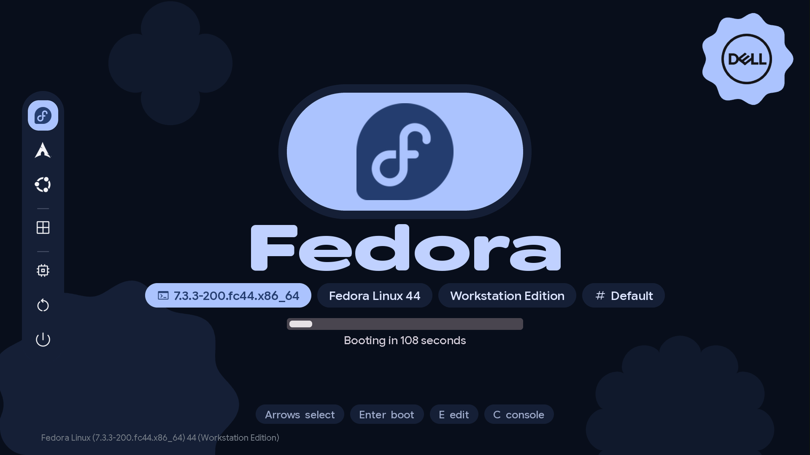

<div align="center">

# Material GRUB

**A Material 3 Expressive theme for GRUB, where the whole screen changes color with the selected boot entry.**

[](https://github.com/LucaCraft89/material-grub/actions/workflows/ci.yml)
[](LICENSE)




</div>

Every boot entry gets its own full-screen scene with its own Material 3 palette, derived from the
distro's brand colour. Move the selection and the entire screen, rail and pills included, follows.
Kernel versions, system versions and recovery entries are shown as info pills, and a
sectioned icon rail keeps you oriented. All text is set in [Google Sans Flex](https://fonts.google.com/specimen/Google+Sans+Flex).

## Features

- **Per-entry dynamic colour.** 54 catalog entries (48 distros, Windows 10/11, Firmware, Restart, Shut down, plus a Tux fallback), each with a seed colour fed through the Material 3 *Expressive* dark scheme.
- **Info pills per entry.** Kernel version, OS name and version, edition, "Default", "Rescue mode", `on /dev/sdXN` for other installs.
- **Advanced options done right.** On Fedora (BLS) the top level shows only the default kernel; everything else, including the rescue entry, lives under **Advanced options**. Advanced shows the distro icon plus a **gear**, recovery shows a **wrench**.
- **Section rail.** A slim left rail: *Linux | Windows | System*. The selected slot is highlighted in the scene's palette, and all kernels of one distro share one slot, so the selector does not jump while you scroll through kernels.
- **Your machine's firmware logo.** The UEFI (BGRT) logo is converted at config time and drawn in a cookie shape at the top right. Verified with a real Dell logo and synthetic white-on-black, black-on-white and coloured logos (HP/Acer/Asus style). Machines that do not expose a BGRT (some MSI/Gigabyte boards) simply show the empty cookie.
- **Raw entry title, always visible** (small, muted) at the bottom of the screen, so it is obvious what GRUB actually sees if parsing ever goes wrong.
- **Case-insensitive name matching.** Entry titles are matched to a distro by name, not only by GRUB's `--class`. Unknown Linux falls back to Tux; an unknown Windows version falls back to Windows 11.
- **Many screens, one package.** Scenes are rendered per aspect ratio (16:9, 16:10, 21:9, 32:9) and a tiny `theme.txt` is generated per resolution: 1280×720, 1920×1080, 1920×1200, 2560×1080, 2560×1440, 2880×1800, 3440×1440, 3840×1080, 3840×1600, 3840×2160, 5120×1440, 5120×2160. Screens 1800 or more pixels high (4K, 2880×1800, 5120×2160) get **native 2160-high scenes** instead of an upscaled 1080 design, so text, glyphs and the rail stay sharp.
- **Dark (default) or light.** `sudo ./install.sh --scheme light` builds the light Material 3 Expressive scheme: neutral countdown, raw-name and progress colours, the desktop colour and the rail glyphs switch with it (contrast checked: all text at least 5:1; see the [gallery](docs/gallery.md)).
- **Non-Latin names.** The bundled font is Latin (incl. Latin Extended and Vietnamese). Cyrillic, Greek, CJK and other titles use GRUB's own `unicode.pf2` as glyph fallback in the menu line, and any installed system font (via fontconfig) in the info pills.
- **Menu always visible.** Fedora hides the GRUB menu after a successful boot; the installer keeps it on screen.

## Gallery

Screenshots of every style, the light scheme and the ultrawide layout, plus a rendered sample of all 54 supported distros: **[docs/gallery.md](docs/gallery.md)**. Using a Ventoy stick? See **[docs/ventoy.md](docs/ventoy.md)**.

## How it works (and what GRUB cannot do)

GRUB themes are static: no animation, no runtime recolouring, no blur, bitmap fonts only. This theme works
within those limits:

```
                    ┌────────────────────── at build time (your PC, once) ───────────────────────┐
 catalog.py ──► Material 3 palettes ──► scene renderer ──► dist/material-grub (scenes, fonts, tools)
                                                              │
                    ┌────────────── at every grub-mkconfig / kernel change (root) ──────────────┘
                    ▼
  05_material (grub.d) ─► picks resolution bundle, copies scenes, converts the BGRT logo
  material-grub-classes ─► names the entries, builds the BLS "default + Advanced" mirrors
  material-grub-scenes  ─► bakes info pills, gear/wrench hero and the rail into one PNG per entry
                    ▼
  GRUB ─► shows the PNG that belongs to the highlighted entry (via a unique per-entry class)
```

The central trick: a `boot_menu` that shows one full-screen item at a time, where each item's "icon" is a
whole scene. Selection changes swap the scene, which gives the whole-screen colour change.

**Not possible in GRUB, and therefore not in this theme**

| Wish | Reality |
|---|---|
| Animated colour transitions / spring motion | No animation engine; scene changes are instant. |
| Wavy (M3 Expressive) progress bar | The bar is a stretched 9-slice image; it is a flat rounded pill instead. |
| Countdown / raw-name text coloured per entry | Colours in `theme.txt` are global, so they are neutral. |
| Peeking neighbour entries | `boot_menu` only draws whole items. |
| Reading the UEFI logo live at boot | GRUB has no BGRT reader; it is converted whenever the config is regenerated. |
| One `theme.txt` for every resolution | Sizes are in pixels; a bundle per resolution is generated, GRUB scales the scenes. |

## Install

One command. The installer detects your distro, **installs every dependency**, builds the theme in a temporary
directory, picks your screen resolution and installs it. It needs root, so run it with `sudo`:

```sh
git clone https://github.com/LucaCraft89/material-grub.git
cd material-grub
sudo ./install.sh
```

Then reboot. That's it.

> ⚠️ This modifies your bootloader configuration. The installer backs up `/etc/default/grub` and `grub.cfg` to
> `/var/backups/material-grub`, and `sudo ./install.sh --uninstall` reverts everything. Know how to boot a live USB
> before you try it on your only machine.

**What it does** (it prints numbered steps and a live progress counter, so you can always see it is working; a full run takes about 2 to 4 minutes)

1. Installs dependencies with your package manager: GRUB tools (`mkconfig`, `mkfont`), librsvg (`rsvg-convert`), Python 3 with `venv` and `pip`,
   and Pillow. Supported: `dnf` (Fedora, RHEL family), `apt` (Debian, Ubuntu, Mint, Pop!_OS), `pacman` (Arch family),
   `zypper` (openSUSE), `apk` (Alpine), `xbps` (Void). Python build requirements (`fonttools`, `materialyoucolor`) go into a throw-away virtualenv.
2. Renders the scenes (a few minutes) into `/var/tmp`, leaving the cloned repository untouched.
3. Auto-detects the resolution (existing `GRUB_GFXMODE`, otherwise your panel's preferred mode) and sets `GRUB_GFXMODE`.
4. Installs the package to `/usr/share/material-grub`, the hooks to `/etc/grub.d/` (`05_material`, `15_material_menu`,
   `90_material_system`) and a systemd path unit that re-applies everything when `grub.cfg`, `/boot/loader/entries` or
   `grubenv` change, then regenerates `grub.cfg`.

**Options**

```sh
sudo ./install.sh --res 1920x1200   # force a resolution instead of auto-detecting
sudo ./install.sh --scheme light    # light variant instead of dark
sudo ./install.sh --style list      # rail (default) | clean | list; also --no-hints, --no-cookie, --no-logo
sudo ./install.sh --no-deps         # you installed the dependencies yourself
sudo ./install.sh --stage-only      # install deps and build, but do not touch GRUB
sudo ./install.sh --keep-build      # keep the temporary build directory
sudo ./install.sh --uninstall       # remove the theme and hooks
```

**Interactive installer (TUI).** Run in a terminal without `--yes`, `./install.sh` asks for whatever you did not give as a flag (resolution, style, colour scheme, cookie/logo, key hints, extras; on immutable systems also your consent). Left: the current question and a tab strip of the steps; right: a call-out explaining the highlighted option; the last tab is a summary with the equivalent non-interactive command. The resolution step proposes your **primary monitor** (X11 `xrandr`, then GNOME/KDE/wlroots Wayland tools run as your own user, then the DRM sysfs, then `GRUB_GFXMODE`) and lets you pick another detected screen or type `WxH`. GRUB draws on whichever output the firmware chooses, usually the primary one. `--no-tui` (or `--yes`, or no terminal) keeps the old fully automatic behaviour; `--tui` forces the questions. Without curses or with a dumb terminal it falls back to plain prompts. Status: the parsers are unit-tested on sample outputs and the TUI is driven through a pty at 80x24 in the tests; the GNOME (Mutter) parser has only been tested on a hand-written sample, and none of the desktop tools have been run on real multi-monitor setups here.

**Styles** (`STYLE` in `/etc/material-grub.conf`, change with `sudo material-grub-apply`; the images are the same for all of them): `rail` is the full-screen design with an icon rail, `clean` is full screen with the previous and next entries peeking in above and below and label chips on the edges, `list` is a centred list of icon-in-shape plus name pill. `COOKIE`, `LOGO` and `HINTS` switch the top-right cookie, the firmware logo inside it and the key-hint pills.

The installer always builds the theme from source (there are no prebuilt downloads); `--pkg DIR` installs a package you built elsewhere, which is how immutable hosts without build tools work.

**Supported resolutions:** `1280x720`, `1920x1080`, `1920x1200`, `2560x1080`, `2560x1440`, `2880x1800`, `3440x1440`, `3840x1080`, `3840x1600`, `3840x2160`, `5120x1440`, `5120x2160`.
Anything else snaps to the closest aspect ratio. The scene sets are 16:9, 16:10, 21:9 and 32:9; screens at least 1800 px high use a 2160-high set
(four times the pixels, about 20 MB per set). The installer builds only the set for the resolution it detects (or `--res`), so after
switching monitors or `GRUB_GFXMODE`, run `sudo ./install.sh --res WxH` again.

**Update:** `git pull && sudo ./install.sh`  **Uninstall:** `sudo ./install.sh --uninstall`. To restore the original
GRUB files, copy them back from `/var/backups/material-grub`.

**Not supported:** NixOS (declarative GRUB) and immutable/ostree systems such as Silverblue or Bazzite, where `/usr` is read-only
(`--force` tries anyway). Systems without systemd work, but you must re-run the installer after kernel changes.

<details>
<summary>Manual install for developers (make targets)</summary>

```sh
make venv        # virtualenv with the build requirements
make package     # render scenes + bundles into dist/material-grub
make install RES=1920x1200   # SCHEME=light for the light variant
```

The Google Sans Flex font is bundled in `fonts/` (SIL OFL 1.1, unmodified upstream copy). Set `GSF_FONT=/path/to/font.ttf` to use another copy.
</details>

### Ventoy

The same theme works on a [Ventoy](https://www.ventoy.net) USB stick (all three styles, dark and light), and it follows the ISOs on the stick without installing again: add, rename or remove files on any computer. No root needed:

```sh
./install.sh --ventoy        # a TUI picks the stick, resolutions, style and scheme
```

Everything about it (screenshots, options, how matching works, limits, what was tested): **[docs/ventoy.md](docs/ventoy.md)**.

### Other distros

The installer detects `grub2-mkconfig` (Fedora/RHEL) and `grub-mkconfig` (Debian, Ubuntu, Arch, ...). Classic
`menuentry`/`submenu` entries (Debian-family and Arch style "Advanced options for ...") are annotated and themed
directly. Fedora's BootLoaderSpec (BLS) entries get the *default kernel on top, rest under Advanced options*
structure through mirror directories in `/boot/loader/material-top` and `/boot/loader/material-adv`; Fedora's own
files are never edited. Systems without `blscfg` (Debian, Ubuntu, Arch: classic `menuentry`/`submenu`) are themed directly from `grub.cfg`; `blscfg` calls with `--path` or `--show-*` options are left untouched (themed by class, no pills or Advanced grouping). **Fedora 44 is the primary target; other distros have not been tested on real hardware.**

### Immutable systems (ostree / bootc: Silverblue, Kinoite, Bazzite, uCore, ...) - experimental

When `/run/ostree-booted` exists, `install.sh` switches to an immutable layout (it explains it and asks first; `--yes` skips the question, `--immutable` forces it):

- Nothing is written under `/usr`. The package, a Python venv (only if Pillow is missing) and the post-processing script live in `/var/lib/material-grub`; the units go in `/etc/systemd/system`.
- No `grub2-mkconfig` ever runs on these systems, so the `/etc/grub.d` hooks would never execute. Instead the **static `/boot/grub2/grub.cfg`** is edited directly (`install/bin/material-grub-static`): a theme block, the Restart/Shut down entries and the usual structured BLS menu. An untouched copy is kept in `/var/backups/material-grub`, and `--uninstall` restores it.
- Build tools (`grub-mkfont`, `rsvg-convert`) are never layered with `rpm-ostree`. If they are missing, the package is built in a throw-away `podman` container; or build it elsewhere with `./install.sh --stage-only --dist-out DIR` and install with `--pkg DIR/material-grub`.
- ostree replaces `/boot/loader` on every deployment, so the BLS mirrors live in `/boot/grub2/material` instead. ostree writes the next deployment's entry at **shutdown**, so `material-grub-finalize.service` refreshes the mirrors after `ostree-finalize-staged`. A raw **All boot entries** submenu (the live, unmirrored list) is always added as a safety net.
- `bootupctl update` rewrites `grub.cfg`; the path unit notices and re-applies the theme.

What was tested: the whole flow in a container with a read-only `/usr` and a simulated static `grub.cfg` and `/boot/loader` swap (install, refresh after a deployment swap, re-apply after a `grub.cfg` rewrite, uninstall, idempotency), the resulting `grub.cfg` booted in QEMU/OVMF, and the unit files with `systemd-analyze verify`. **Not tested:** a real ostree/bootc boot, `ostree-finalize-staged` ordering at shutdown, SELinux labels on `/var/lib/material-grub`, `bootupctl update`, a read-only `/boot`.

## Customising

- **Runtime options:** `/etc/material-grub.conf` (`RAW_NAME`, `COUNTDOWN`, `LOGO`, `COOKIE`, `HINTS`, `TIMEOUT`, `STYLE`); apply with `sudo material-grub-apply`. The top-right cookie and the key-hint pills are drawn at install/apply time, not baked into the downloaded images, so they are switchable without a rebuild (`sudo ./install.sh --no-hints` writes `HINTS=off`). Only the colour scheme is still a build choice.

- **Seed colours, names, aliases:** `scripts/catalog.py` is the single source of truth. Colours marked `proposed` are hand-picked, not official, and are happy to be changed (open a PR). Rebuild with `make package`.
- **Add a distro:** add a row to `catalog.py` (key, title, subtitle, glyph, seed colour, aliases); the full guide is [docs/adding-a-distro.md](docs/adding-a-distro.md). Unknown distros already fall back to Tux.
- **Layout and shapes:** `scripts/render_scene.py` (background scene) and `install/bin/material-grub-scenes` (hero, pills, rail, drawn at config time).

## Development

```sh
make screenshots          # QEMU + OVMF run, writes docs/screenshots/
.venv/bin/python scripts/qemu_tree.py build/shots-tree 1920x1080 down ret   # poke the VM by hand
```

`sh tests/run.sh` runs the fast checks (syntax, unit tests, a fake-`/boot` pipeline test against `dist/material-grub`); `python3 tests/boot_smoke.py 1920x1080 dark` boots the package in QEMU and checks what GRUB drew. GitHub Actions runs both, plus the installer in Fedora, Ubuntu, Debian, Arch, openSUSE and Alpine containers, on every PR. The workflow itself has not run yet (only its commands were run locally).

Nothing in development touches your real bootloader; `scripts/make_screenshots.py` builds a throw-away ESP tree.

## Contributing

Bug reports and distro requests have issue templates (they ask for distro, GRUB version, resolution, BLS and `entries.json`), and PRs have a template with a test checklist. See [docs/adding-a-distro.md](docs/adding-a-distro.md) to add or fix a distro.

## Status

Developed and tested on Fedora 44 (GRUB 2.12, BLS) with QEMU/OVMF at 1920×1080, 2560×1080, 1920×1200,
3440×1440, 3840×2160, 2880×1800, 3840×1600 and 3840×1080. 5120×1440 and 5120×2160 are built and the scenes were checked as images, but
QEMU/OVMF cannot create 5120-wide GOP modes, so they have **not** been booted. The first version ran on real hardware; the per-entry pills/Advanced-options structure has been verified
in QEMU with the real `blscfg` module and a dry-run on real BLS entries.

The installer's dependency detection/installation and the full theme build were verified in fresh **Fedora, Debian,
Ubuntu, Arch, openSUSE and Alpine** containers (`--stage-only`). The step that actually rewrites GRUB has so far only been
run on Fedora 44; reports and PRs from other distros are very welcome.

## Credits and licenses

Code: [MIT](LICENSE). The bundled Google Sans Flex font is under the SIL OFL 1.1 ([fonts/](fonts/)); the generated `MG-*` bitmap fonts are derivatives and stay under the OFL. Icons and colour libraries: see [THIRD_PARTY.md](THIRD_PARTY.md). This project is not affiliated with or endorsed by Google. Distro names and
logos are trademarks of their owners and are used only to identify boot entries.
