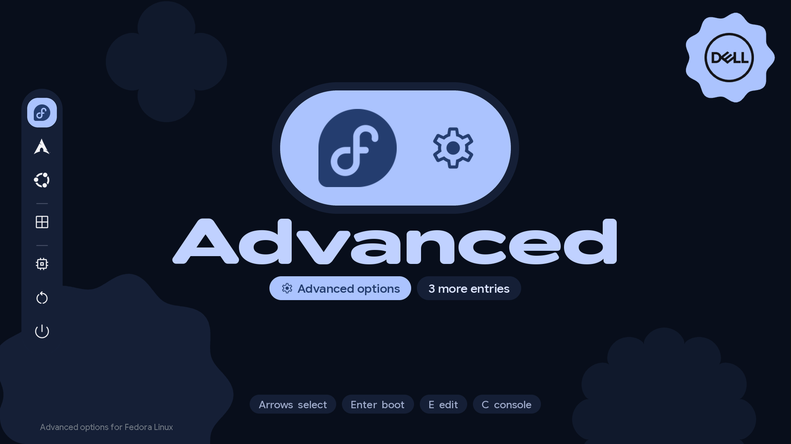
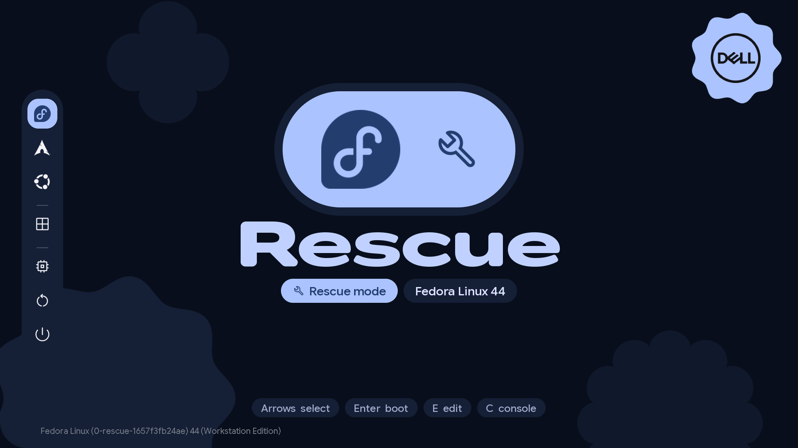
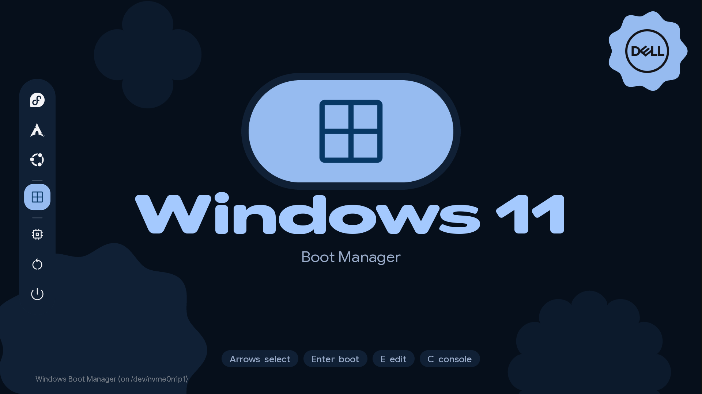
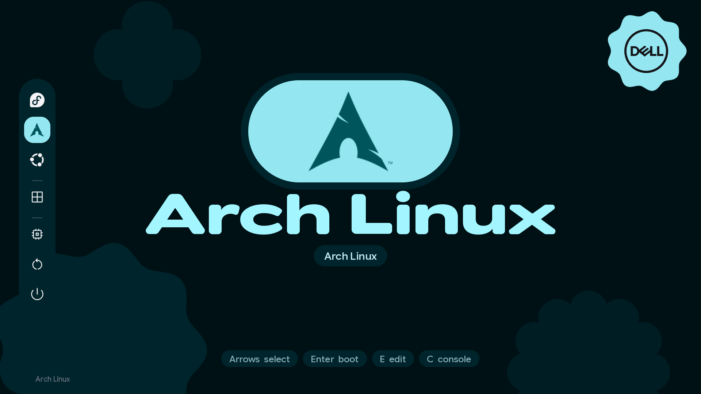
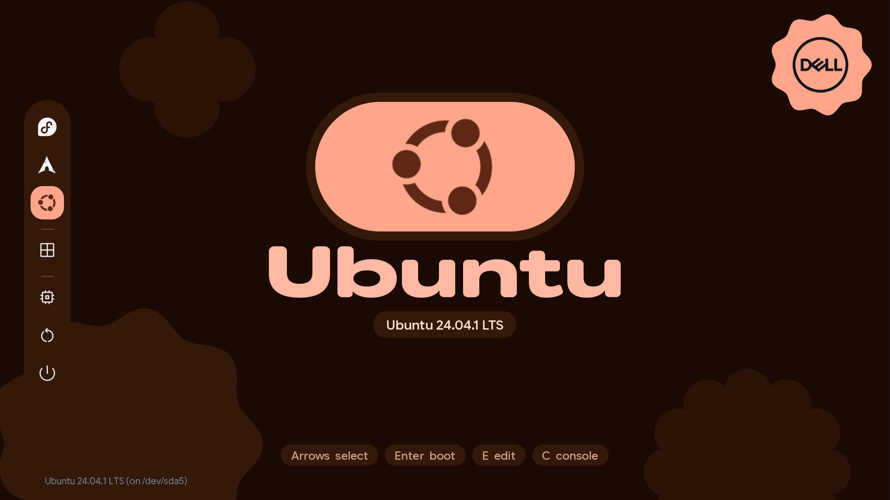
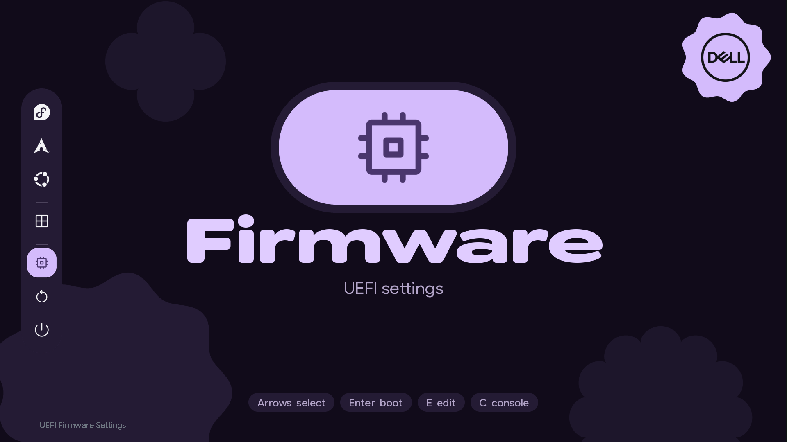
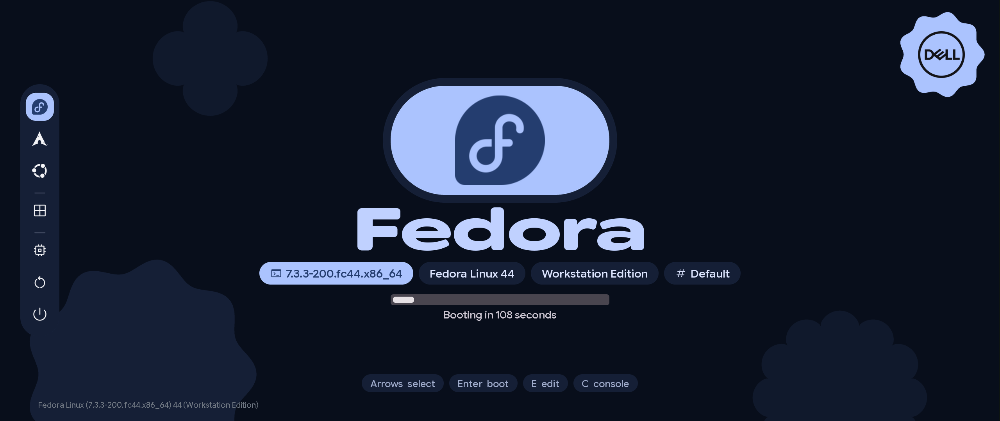

<div align="center">

# Material GRUB

**A Material 3 Expressive theme for GRUB, where the whole screen changes color with the selected boot entry.**

[](LICENSE)


</div>

Every boot entry gets its own full-screen scene with its own Material 3 palette, derived from the
distro's brand colour. Move the selection and the entire screen, rail and pills included, follows.
Kernel versions, system versions and recovery entries are shown as info pills, and a
sectioned icon rail keeps you oriented. All text is set in [Google Sans Flex](https://fonts.google.com/specimen/Google+Sans+Flex).

## Features

- **Per-entry dynamic colour.** 54 catalog entries (48 distros, Windows 10/11, Firmware, Restart, Shut down, plus a Tux fallback), each with a seed colour fed through the Material 3 *Expressive* dark scheme.
- **Info pills per entry.** Kernel version, OS name and version, edition, "Default", "Rescue mode", `on /dev/sdXN` for other installs.
- **Advanced options done right.** On Fedora (BLS) the top level shows only the default kernel; everything else, including the rescue entry, lives under **Advanced options**. Advanced shows the distro icon plus a **gear**, recovery shows a **wrench**.
- **Section rail.** A slim left rail: *Linux | Windows | System*. The selected slot is highlighted in the scene's palette, and all kernels of one distro share one slot, so the selector does not jump while you scroll through kernels.
- **Your machine's firmware logo.** The UEFI (BGRT) logo is converted at config time and drawn in a cookie shape at the top right. Verified with a real Dell logo and synthetic white-on-black, black-on-white and coloured logos (HP/Acer/Asus style). Machines that do not expose a BGRT (some MSI/Gigabyte boards) simply show the empty cookie.
- **Raw entry title, always visible** (small, muted) at the bottom of the screen, so it is obvious what GRUB actually sees if parsing ever goes wrong.
- **Case-insensitive name matching.** Entry titles are matched to a distro by name, not only by GRUB's `--class`. Unknown Linux falls back to Tux; an unknown Windows version falls back to Windows 11.
- **Many screens, one package.** Scenes are rendered per aspect ratio (16:9, 16:10, 21:9) and a tiny `theme.txt` is generated per resolution: 1280×720, 1920×1080, **1920×1200**, **2560×1080**, 2560×1440, **3440×1440**, 3840×2160.
- **Menu always visible.** Fedora hides the GRUB menu after a successful boot; the installer keeps it on screen.

## Gallery

<table>
<tr>
<td></td>
<td></td>
</tr>
<tr>
<td></td>
<td></td>
</tr>
<tr>
<td></td>
<td></td>
</tr>
</table>

Ultrawide (2560×1080):



<sub>All screenshots are real GRUB output, captured in QEMU + OVMF with `make screenshots`. The Dell logo is this author's firmware logo.</sub>

## How it works (and what GRUB cannot do)

GRUB themes are static: no animation, no runtime recolouring, no blur, bitmap fonts only. This theme works
within those limits:

```
                    ┌────────────────────── at build time (your PC, once) ───────────────────────┐
 catalog.py ──► Material 3 palettes ──► scene renderer ──► dist/material-grub (scenes, fonts, tools)
                                                              │
                    ┌────────────── at every grub-mkconfig / kernel change (root) ──────────────┘
                    ▼
  05_material (grub.d) ─► picks resolution bundle, copies scenes, converts the BGRT logo
  material-grub-classes ─► names the entries, builds the BLS "default + Advanced" mirrors
  material-grub-scenes  ─► bakes info pills, gear/wrench hero and the rail into one PNG per entry
                    ▼
  GRUB ─► shows the PNG that belongs to the highlighted entry (via a unique per-entry class)
```

The central trick: a `boot_menu` that shows one full-screen item at a time, where each item's "icon" is a
whole scene. Selection changes swap the scene, which gives the whole-screen colour change.

**Not possible in GRUB, and therefore not in this theme**

| Wish | Reality |
|---|---|
| Animated colour transitions / spring motion | No animation engine; scene changes are instant. |
| Wavy (M3 Expressive) progress bar | The bar is a stretched 9-slice image; it is a flat rounded pill instead. |
| Countdown / raw-name text coloured per entry | Colours in `theme.txt` are global, so they are neutral. |
| Peeking neighbour entries | `boot_menu` only draws whole items. |
| Reading the UEFI logo live at boot | GRUB has no BGRT reader; it is converted whenever the config is regenerated. |
| One `theme.txt` for every resolution | Sizes are in pixels; a bundle per resolution is generated, GRUB scales the scenes. |

## Requirements

- Linux with **GRUB 2.12** (the version it was tested with), UEFI recommended. `/boot` must be readable by GRUB (ext4/xfs/btrfs/FAT).
- Build machine: `python3` (with `venv`), **ImageMagick** (`magick`), `grub-mkfont` / `grub2-mkfont`, the Google Sans Flex font.
- Target machine at runtime: `python3` + **Pillow**, `grub-mkconfig` / `grub2-mkconfig`. Without Pillow the theme still works but without per-entry pills and the rail.
- Optional, for screenshots/tests: `qemu-system-x86_64` and OVMF (`edk2-ovmf`).

| Distro | Packages |
|---|---|
| Fedora | `sudo dnf install grub2-tools ImageMagick python3 python3-pillow` |
| Debian / Ubuntu | `sudo apt install grub-common imagemagick python3 python3-venv python3-pil` |
| Arch | `sudo pacman -S grub imagemagick python python-pillow` |

## Install

> ⚠️ This modifies your bootloader configuration. The installer backs up `/etc/default/grub` and `grub.cfg`
> to `/var/backups/material-grub`, and `install/uninstall.sh` reverts everything. Know how to boot a live USB
> before you try it on your only machine.

**1. Get the sources**

```sh
git clone https://github.com/LucaCraft89/material-grub.git
cd material-grub
```

**2. Get the font.** Download *Google Sans Flex* from [Google Fonts](https://fonts.google.com/specimen/Google+Sans+Flex)
(*Get font → Download all*, SIL OFL 1.1) and install the variable `.ttf` where the build can find it, either:

```sh
mkdir -p ~/.local/share/fonts && cp GoogleSansFlex-VariableFont_*.ttf ~/.local/share/fonts/
# or point at it explicitly:
export GSF_FONT=/path/to/GoogleSansFlex-VariableFont_GRAD,ROND,opsz,slnt,wdth,wght.ttf
```

**3. Build the package** (renders a few hundred scene images; takes a few minutes):

```sh
make venv
make package
```

**4. Install** for your screen's resolution (pick one from the supported list below):

```sh
make install RES=1920x1200
# equivalent: sudo sh install/install.sh --res 1920x1200
```

This installs the package to `/usr/share/material-grub`, the hooks to `/etc/grub.d/`
(`05_material`, `15_material_menu`, `90_material_system`), a systemd path unit that re-applies everything when
`grub.cfg`, `/boot/loader/entries` or `grubenv` change, sets `GRUB_GFXMODE`, and regenerates `grub.cfg`.

**5. Reboot.** The menu is forced visible (Fedora normally hides it after a successful boot).

**Supported resolutions:** `1280x720`, `1920x1080`, `1920x1200`, `2560x1080`, `2560x1440`, `3440x1440`, `3840x2160`.
Anything else snaps to the closest aspect ratio. The aspect-ratio scene sets are 16:9, 16:10 and 21:9.

**Update:** `git pull && make package && sudo sh install/install.sh --res <your resolution>`

**Uninstall:** `make uninstall` (or `sudo sh install/uninstall.sh`). To restore the original GRUB files, copy them
back from `/var/backups/material-grub`.

### Other distros

The installer detects `grub2-mkconfig` (Fedora/RHEL) and `grub-mkconfig` (Debian, Ubuntu, Arch, ...). Classic
`menuentry`/`submenu` entries (Debian-family and Arch style "Advanced options for ...") are annotated and themed
directly. Fedora's BootLoaderSpec (BLS) entries get the *default kernel on top, rest under Advanced options*
structure through mirror directories in `/boot/loader/material-top` and `/boot/loader/material-adv`; Fedora's own
files are never edited. **Fedora 44 is the primary target; other distros have not been tested on real hardware.**

## Customising

- **Seed colours, names, aliases:** `scripts/catalog.py` is the single source of truth. Colours marked `proposed` are hand-picked, not official, and are happy to be changed (open a PR). Rebuild with `make package`.
- **Add a distro:** add a row to `catalog.py` (key, title, subtitle, glyph, seed colour, aliases). Glyphs come from `vendor/font-logos` or any SVG. Unknown distros already fall back to Tux.
- **Layout and shapes:** `scripts/render_scene.py` (background scene) and `install/bin/material-grub-scenes` (hero, pills, rail, drawn at config time).

## Development

```sh
make screenshots          # QEMU + OVMF run, writes docs/screenshots/
.venv/bin/python scripts/qemu_tree.py build/shots-tree 1920x1080 down ret   # poke the VM by hand
```

Nothing in development touches your real bootloader; `scripts/make_screenshots.py` builds a throw-away ESP tree.

## Status

Developed and tested on Fedora 44 (GRUB 2.12, BLS) with QEMU/OVMF at 1920×1080, 2560×1080, 1920×1200 and
3440×1440. The first version ran on real hardware; the per-entry pills/Advanced-options structure has been verified
in QEMU with the real `blscfg` module and a dry-run on real BLS entries. Reports and PRs from other distros are very welcome.

## Credits and licenses

Code: [MIT](LICENSE). Fonts, icons and colour libraries: see [THIRD_PARTY.md](THIRD_PARTY.md). Distro names and
logos are trademarks of their owners and are used only to identify boot entries.
