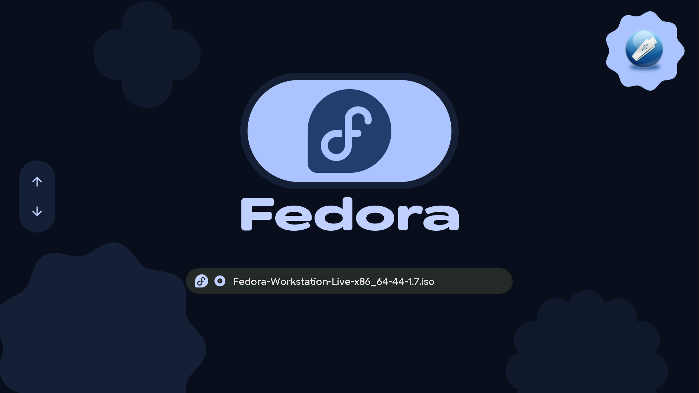
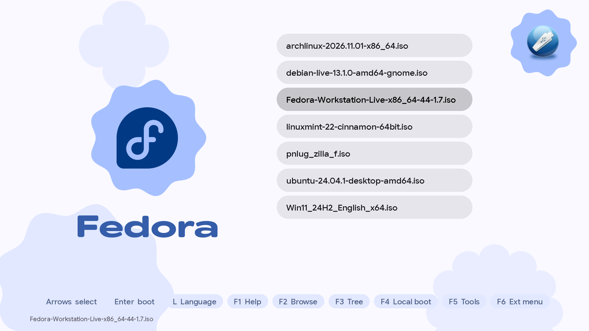
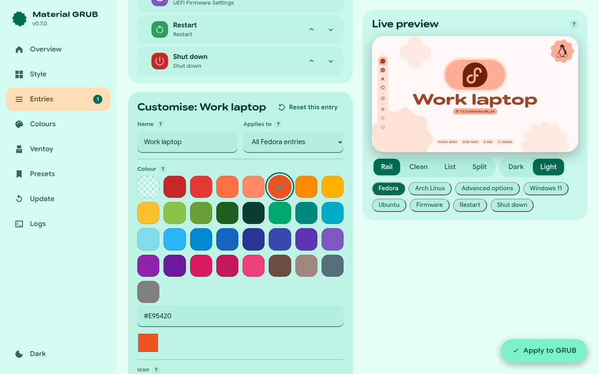

<div align="center">

# Material GRUB

**A Material 3 Expressive theme for GRUB, where the whole screen changes color with the selected boot entry.**

[](https://github.com/LucaCraft89/material-grub/actions/workflows/ci.yml)
[](LICENSE)


</div>

Every boot entry gets its own full-screen scene with its own Material 3 palette, derived from the
distro's brand colour. Move the selection and the entire screen, rail and pills included, follows.
Kernel versions, system versions and recovery entries are shown as info pills, and a
sectioned icon rail keeps you oriented. All text is set in [Google Sans Flex](https://fonts.google.com/specimen/Google+Sans+Flex).

## Getting started

**On your computer's GRUB** (Linux with GRUB 2; about 2 to 4 minutes):

```sh
git clone https://github.com/LucaCraft89/material-grub.git
cd material-grub
sudo ./install.sh          # asks for style, colour scheme and resolution; Enter keeps the defaults
```

> **Material GRUB needs [material-boot-core](https://github.com/LucaCraft89/material-boot-core)**, the code it shares with the other Material Boot parts (Material Plymouth, ...). The installer refuses to go on without it and says so. Packages and the Material Boot bundle bring it along once they are released; until then, install it first (Python 3.9+, Pillow and `rsvg-convert` are needed, as for the theme itself):
>
> ```sh
> git clone https://github.com/LucaCraft89/material-boot-core.git
> sudo sh material-boot-core/packaging/common/install-tree.sh material-boot-core /     # lays the core out like its package does
> sudo material-boot core install --from-package --only core --yes                      # builds its shared data on this machine
> ```

Reboot and the new menu is there. Want another look later? `sudo ./install.sh --style split --scheme light`. Want it gone? `sudo ./install.sh --uninstall` (your original GRUB files are backed up in `/var/backups/material-grub`). Keep a live USB around the first time, since this edits your bootloader configuration.

**On a Ventoy USB stick** (no root, nothing on your computer changes):

```sh
git clone https://github.com/LucaCraft89/material-grub.git
cd material-grub
./install.sh --ventoy      # pick the stick, then style and scheme
```

Boot from the stick. Copy ISOs onto it as usual, from any computer; the theme picks them up by file name.

Which style? Pick by look in the [gallery](docs/gallery.md): `rail`, `clean`, `list` and `split` on the PC, `full` and `list` on Ventoy. All options: [Options](#options), [docs/install.md](docs/install.md) and [Ventoy](#ventoy).

## Ventoy

The same theme runs on the menu of a [Ventoy](https://www.ventoy.net) USB stick, and it follows the ISOs on the stick: add, rename or remove files on any computer and nothing needs to run again. A full-screen picker with the real file name, or a list; dark or light; Ventoy's own menus are themed too, and an image with `pnlug` in its name gets the Pordenone Linux User Group's colours and logo.

<table>
<tr>
<td></td>
<td></td>
</tr>
</table>

```sh
./install.sh --ventoy        # no root; a TUI picks the stick, resolutions, style and scheme
```

Install options, all screenshots and what was tested: **[docs/ventoy.md](docs/ventoy.md)**.

## Features

- **Per-entry dynamic colour.** 54 catalog entries (48 distros, Windows 10/11, Firmware, Restart, Shut down, plus a Tux fallback), each with a seed colour fed through the Material 3 *Expressive* dark scheme.
- **Info pills per entry.** Kernel version, OS name and version, edition, "Default", "Rescue mode", `on /dev/sdXN` for other installs.
- **Advanced options done right.** On Fedora (BLS) the top level shows only the default kernel; everything else, including the rescue entry, lives under **Advanced options**. Advanced shows the distro icon plus a **gear**, recovery shows a **wrench**.
- **Section rail.** A slim left rail: *Linux | Windows | System*. The selected slot is highlighted in the scene's palette, and all kernels of one distro share one slot, so the selector does not jump while you scroll through kernels.
- **Your machine's firmware logo.** The UEFI (BGRT) logo is converted at config time and drawn in a cookie shape at the top right. Verified with a real Dell logo and synthetic white-on-black, black-on-white and coloured logos (HP/Acer/Asus style). Machines that do not expose a BGRT (some MSI/Gigabyte boards) simply show the empty cookie.
- **Raw entry title, always visible** (small, muted) at the bottom of the screen, so it is obvious what GRUB actually sees if parsing ever goes wrong.
- **Case-insensitive name matching.** Entry titles are matched to a distro by name, not only by GRUB's `--class`. Unknown Linux falls back to Tux; an unknown Windows version falls back to Windows 11.
- **Many screens, one package.** Scenes are rendered per aspect ratio (16:9, 16:10, 21:9, 32:9) and a tiny `theme.txt` is generated per resolution: 1280×720, 1920×1080, 1920×1200, 2560×1080, 2560×1440, 2880×1800, 3440×1440, 3840×1080, 3840×1600, 3840×2160, 5120×1440, 5120×2160. Screens 1800 or more pixels high (4K, 2880×1800, 5120×2160) get **native 2160-high scenes** instead of an upscaled 1080 design, so text, glyphs and the rail stay sharp.
- **Dark (default) or light.** `sudo ./install.sh --scheme light` builds the light Material 3 Expressive scheme: neutral countdown, raw-name and progress colours, the desktop colour and the rail glyphs switch with it (contrast checked: all text at least 5:1; see the [gallery](docs/gallery.md)).
- **Non-Latin names.** The bundled font is Latin (incl. Latin Extended and Vietnamese). Cyrillic, Greek, CJK and other titles use GRUB's own `unicode.pf2` as glyph fallback in the menu line, and any installed system font (via fontconfig) in the info pills.
- **Ventoy sticks too.** `./install.sh --ventoy` themes the menu of a Ventoy USB stick (full-screen picker or list, dark or light), see [Ventoy](#ventoy).
- **Menu always visible.** Fedora hides the GRUB menu after a successful boot; the installer keeps it on screen.

## Gallery

Two screenshots of every style (rail, clean, list, split) in dark and light, the same for a Ventoy stick, the ultrawide layout and a rendered sample of all 54 supported distros: **[docs/gallery.md](docs/gallery.md)**. Using a Ventoy stick? See **[docs/ventoy.md](docs/ventoy.md)**.

## Make it yours

One colour for the whole theme, or a colour, name, icon and position per entry, hide entries you never use, windows first or linux first, your own PNG or SVG as an icon, presets to save a look. Everything is stored in `/etc/material-grub/overrides.json` and works without a rebuild:

```sh
sudo ./install.sh --seed '#7E57C2'      # one seed colour for every entry (the TUI offers 32 preset colours)
```

The **editor** (`material-boot ui`, part of material-boot-core) does all of it with a live preview, drag and drop and Ventoy support, in a Material 3 Expressive web UI that opens in your browser. It is a separate package (`material-grub-gui`, or `sudo ./install.sh --with-gui` from a checkout) and is never installed by default: **[docs/gui.md](docs/gui.md)**, [docs/customising.md](docs/customising.md).



More pictures (one colour, per-entry colours, Windows first, the GUI): **[docs/showcase.md](docs/showcase.md)**.

## Options

```sh
sudo ./install.sh                                  # asks for style, scheme and resolution
sudo ./install.sh --res 1920x1200 --style list --scheme light --yes
./install.sh --preview                             # see your own menu as a web page first: no root, nothing installed
sudo ./install.sh --dry-run                        # show the diff of grub.cfg and /etc/default/grub, change nothing
material-boot ui                                   # the editor in your browser: every setting, with a live preview
material-boot                                      # a menu of everything; `material-boot help` lists every command
material-boot grub doctor                          # check the installation (paste it into a bug report)
sudo material-boot grub apply                      # re-apply after editing /etc/material-grub.conf or overrides.json
material-boot core colour | presets | overrides | conf   # the look from a terminal (and `material-boot grub preview | ventoy`)
sudo ./install.sh --uninstall                      # back to your original GRUB files
```

Every rewrite of `grub.cfg` is validated with `grub-script-check`; if anything is wrong the previous file is restored, you are told in the
terminal, the journal and (without a terminal) with `wall`, and GRUB keeps its working menu. If the theme is missing at boot GRUB shows its
plain menu. Windows 10/11 is told apart by mounting the Windows partition **read-only** as root and reading `bootmgfw.efi`; the answer is
recomputed whenever `grub.cfg` is regenerated, so an upgrade from 10 to 11 shows the new icon after the next regeneration.

The theme is always built from source on your machine (there are no prebuilt downloads). Details and every option: [docs/install.md](docs/install.md)
([supported resolutions](docs/install.md#supported-resolutions), immutable systems: [docs/immutable.md](docs/immutable.md), packages: [docs/packaging.md](docs/packaging.md)),
the commands: [docs/cli.md](docs/cli.md), **how to use it, start to finish: [docs/usage.md](docs/usage.md)**; how it works and what GRUB cannot do: [docs/how-it-works.md](docs/how-it-works.md), customising: [docs/customising.md](docs/customising.md).
Does it work on your distro? [Tell us](https://github.com/LucaCraft89/material-grub/issues/new?template=works_on_distro.yml); confirmed systems: [docs/tested-on.md](docs/tested-on.md).

## Development

```sh
make screenshots          # QEMU + OVMF run, writes docs/screenshots/
.venv/bin/python scripts/qemu_tree.py build/shots-tree 1920x1080 down ret   # poke the VM by hand
```

`sh tests/run.sh` runs the fast checks (syntax, unit tests, a fake-`/boot` pipeline test against `dist/material-grub`); `python3 tests/boot_smoke.py 1920x1080 dark` boots the package in QEMU and checks what GRUB drew. GitHub Actions runs both, plus the installer in Fedora, Ubuntu, Debian, Arch, openSUSE and Alpine containers, on every PR. The workflow itself has not run yet (only its commands were run locally).

Nothing in development touches your real bootloader; `scripts/make_screenshots.py` builds a throw-away ESP tree.

## Contributing

Bug reports and distro requests have issue templates (they ask for distro, GRUB version, resolution, BLS and `entries.json`), and PRs have a template with a test checklist. See [docs/adding-a-distro.md](docs/adding-a-distro.md) to add or fix a distro.

## Status

Developed and tested on Fedora 44 (GRUB 2.12, BLS) with QEMU/OVMF at 1920×1080, 2560×1080, 1920×1200,
3440×1440, 3840×2160, 2880×1800, 3840×1600 and 3840×1080. 5120×1440 and 5120×2160 are built and the scenes were checked as images, but
QEMU/OVMF cannot create 5120-wide GOP modes, so they have **not** been booted. The first version ran on real hardware; the per-entry pills/Advanced-options structure has been verified
in QEMU with the real `blscfg` module and a dry-run on real BLS entries.

The installer's dependency detection/installation and the full theme build are verified in CI in fresh **Fedora, Debian,
Ubuntu, Arch, openSUSE, Alpine and AlmaLinux 8** containers (`--stage-only`), and the safety nets (plain-menu fallback, rollback) boot in QEMU. The step that actually rewrites GRUB has so far only been
run on Fedora 44; reports and PRs from other distros are very welcome.

## Credits and licenses

Code: [MIT](LICENSE). The bundled Google Sans Flex font is under the SIL OFL 1.1 ([fonts/](fonts/)); the generated `MG-*` bitmap fonts are derivatives and stay under the OFL. Icons and colour libraries: see [THIRD_PARTY.md](THIRD_PARTY.md). This project is not affiliated with or endorsed by Google. Distro names and
logos are trademarks of their owners and are used only to identify boot entries.
