# Supported distros

Every entry below is matched by name (case-insensitive) and by GRUB class. Samples are rendered from the theme code (dark scheme, 16:9, `rail`-less hero scene with the cookie); this page is generated by `scripts/gen_distro_table.py`.

<!-- distros:begin -->
| Sample | Name | Key | Seed colour | Also matches (entry names / classes) |
|---|---|---|---|---|
| 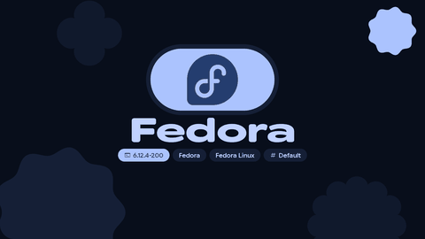 | Fedora | `fedora` | `#294172` (chosen) | `fedora-asahi-remix` |
| 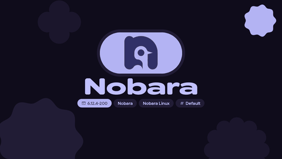 | Nobara | `nobara` | `#5B5BD6` (proposed) | - |
| 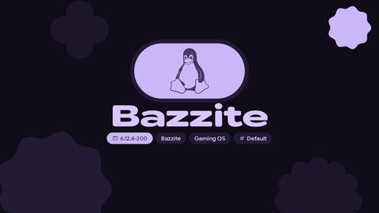 | Bazzite | `bazzite` | `#8A4FFF` (proposed) | `steamos`, `chimeraos` |
| 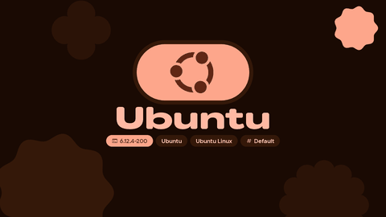 | Ubuntu | `ubuntu` | `#E95420` (brand colour (Simple Icons)) | `xubuntu`, `lubuntu`, `ubuntu-mate`, `ubuntu_budgie` |
| 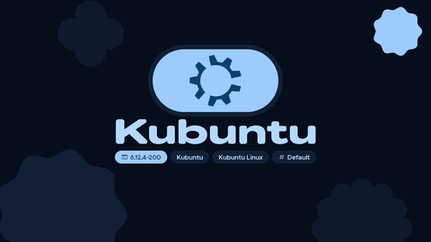 | Kubuntu | `kubuntu` | `#0079C1` (brand colour (Simple Icons)) | - |
| 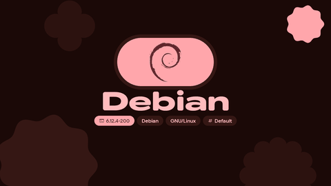 | Debian | `debian` | `#A80030` (chosen) | - |
| 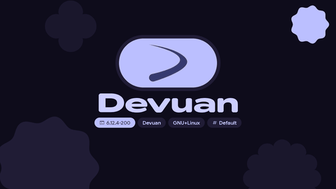 | Devuan | `devuan` | `#6B6FA8` (proposed) | - |
| 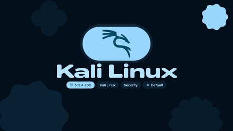 | Kali Linux | `kali` | `#557C94` (brand colour (Simple Icons)) | `kali-linux`, `kali_linux`, `kali_gnu_linux` |
| 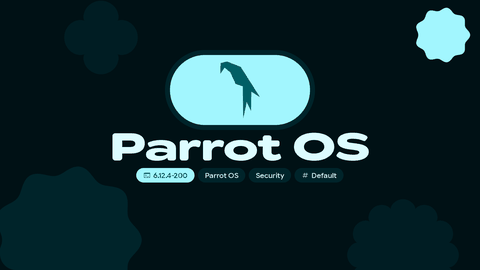 | Parrot OS | `parrot` | `#15E0ED` (brand colour (Simple Icons)) | `parrot-os`, `parrot_security` |
| 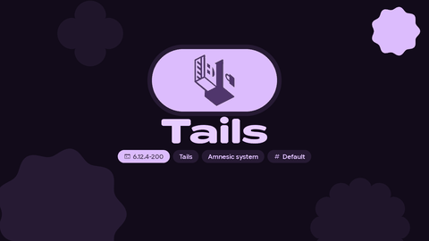 | Tails | `tails` | `#56347C` (brand colour (Simple Icons)) | - |
| 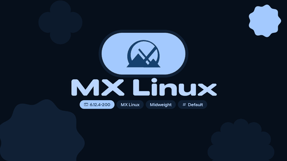 | MX Linux | `mxlinux` | `#3D6EA8` (proposed) | `mx-linux`, `mx_linux` |
| 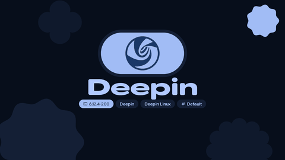 | Deepin | `deepin` | `#007CFF` (brand colour (Simple Icons)) | `deepin-linux` |
| 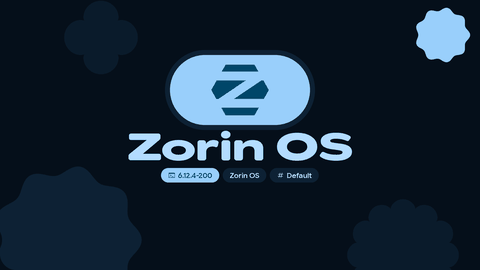 | Zorin OS | `zorin` | `#15A6F0` (brand colour (Simple Icons)) | `zorin-os`, `zorinos` |
| 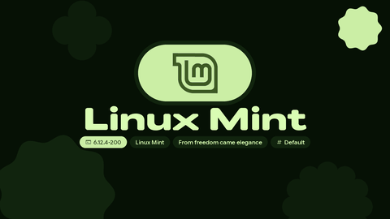 | Linux Mint | `linuxmint` | `#87CF3E` (brand colour (Simple Icons)) | `mint`, `linux_mint`, `linux-mint` |
| 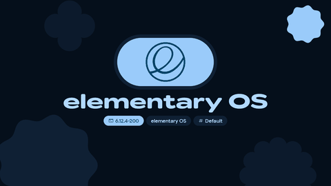 | elementary OS | `elementary` | `#64BAFF` (brand colour (Simple Icons)) | `elementaryos`, `elementary-os` |
| 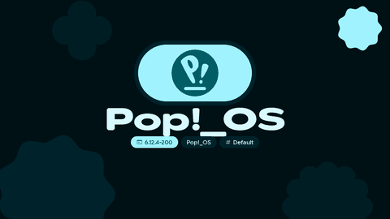 | Pop!_OS | `pop` | `#48B9C7` (brand colour (Simple Icons)) | `pop_os`, `pop-os`, `popos`, `pop!_os`, `pop_` |
| 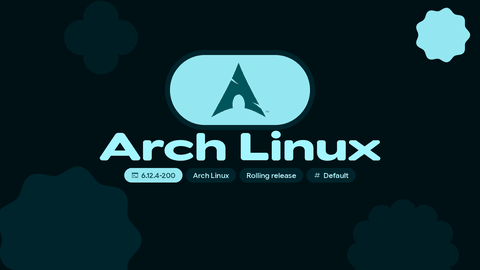 | Arch Linux | `arch` | `#00A6B2` (chosen) | `archlinux`, `arch_linux` |
| 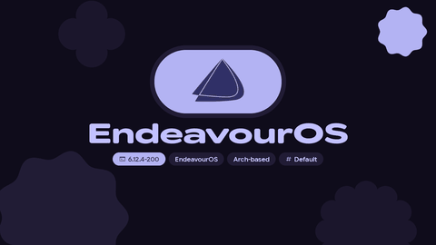 | EndeavourOS | `endeavouros` | `#7F7FFF` (brand colour (Simple Icons)) | `endeavour`, `endeavour_os` |
| 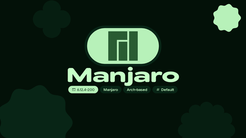 | Manjaro | `manjaro` | `#35BF5C` (brand colour (Simple Icons)) | `manjaro-linux`, `manjaro_linux` |
| 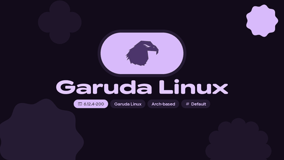 | Garuda Linux | `garuda` | `#8C4FD8` (proposed) | `garuda-linux`, `garuda_linux` |
| 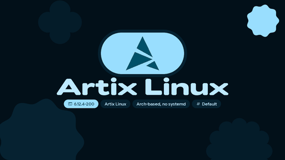 | Artix Linux | `artix` | `#10A0CC` (brand colour (Simple Icons)) | `artix-linux`, `artix_linux` |
|  | ArcoLinux | `arcolinux` | `#3B8DD9` (proposed) | - |
| 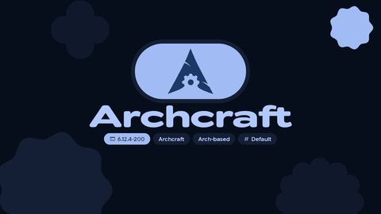 | Archcraft | `archcraft` | `#4C8BF5` (proposed) | - |
| 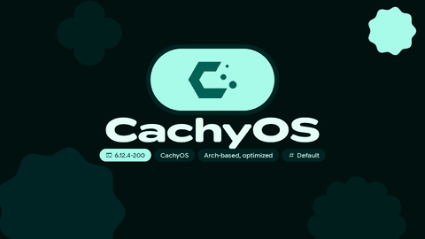 | CachyOS | `cachyos` | `#2BB5A0` (proposed) | `cachy`, `cachy_os` |
|  | BigLinux | `biglinux` | `#2E7DD7` (proposed) | - |
| 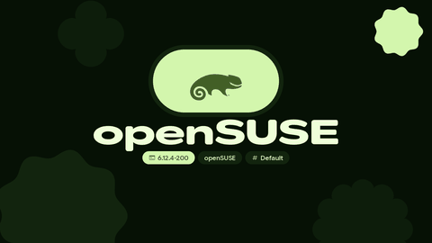 | openSUSE | `opensuse` | `#73BA25` (brand colour (Simple Icons)) | `suse`, `opensuse-leap`, `opensuse-tumbleweed`, `opensuse_leap`, `opensuse_tumbleweed`, `sles`, `sled` |
| 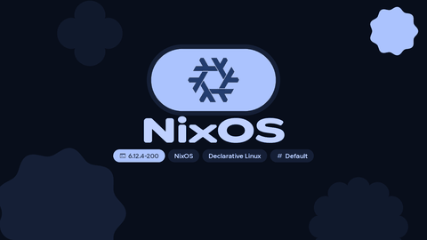 | NixOS | `nixos` | `#5277C3` (brand colour (Simple Icons)) | - |
| 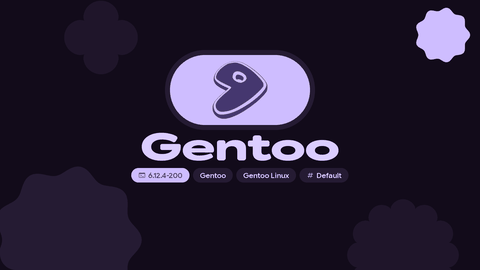 | Gentoo | `gentoo` | `#54487A` (brand colour (Simple Icons)) | - |
| 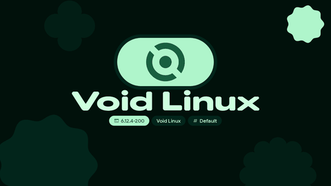 | Void Linux | `void` | `#478061` (brand colour (Simple Icons)) | `void-linux`, `void_linux` |
| 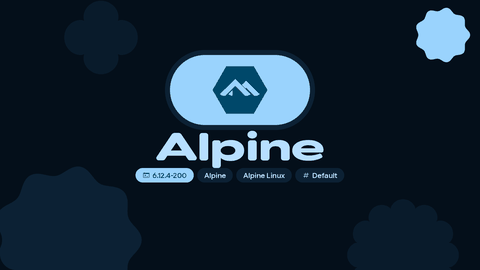 | Alpine | `alpine` | `#0D597F` (brand colour (Simple Icons)) | `alpine-linux`, `alpine_linux` |
| 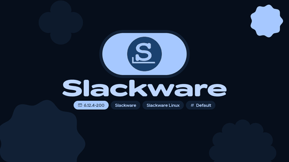 | Slackware | `slackware` | `#5A7FB5` (proposed) | - |
| 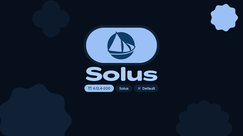 | Solus | `solus` | `#5294E2` (brand colour (Simple Icons)) | - |
| 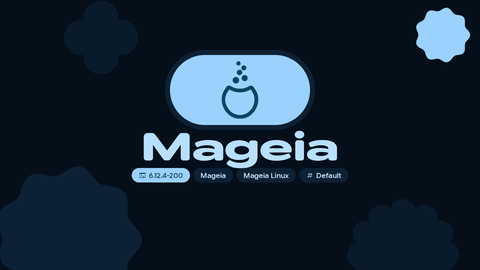 | Mageia | `mageia` | `#2397D4` (proposed) | - |
| 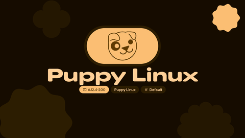 | Puppy Linux | `puppy` | `#C68A3A` (proposed) | `puppy-linux` |
| 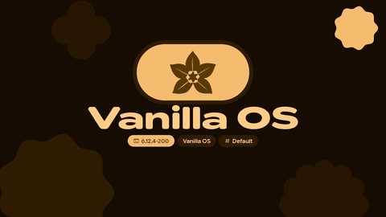 | Vanilla OS | `vanilla` | `#F5A623` (proposed) | `vanilla-os`, `vanillaos` |
| 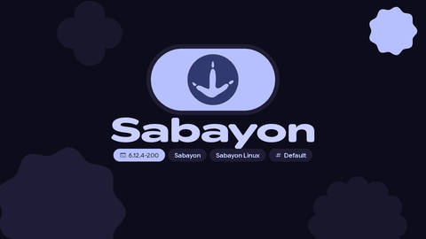 | Sabayon | `sabayon` | `#3D5AFE` (proposed) | - |
| 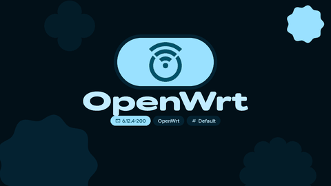 | OpenWrt | `openwrt` | `#00B5E2` (brand colour (Simple Icons)) | - |
| 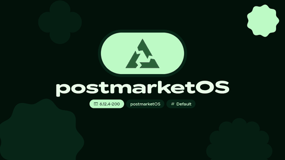 | postmarketOS | `postmarketos` | `#00A651` (proposed) | - |
| 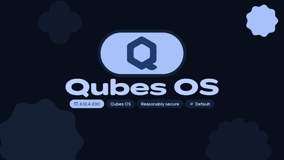 | Qubes OS | `qubes` | `#3874D8` (brand colour (Simple Icons)) | `qubesos`, `qubes-os` |
| 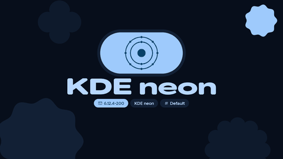 | KDE neon | `neon` | `#1D99F3` (brand colour (Simple Icons)) | `kde-neon`, `kde_neon` |
| 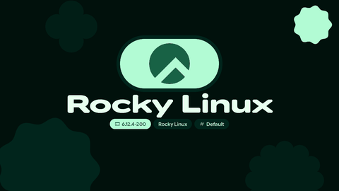 | Rocky Linux | `rocky` | `#10B981` (brand colour (Simple Icons)) | `rocky-linux`, `rocky_linux` |
|  | AlmaLinux | `almalinux` | `#0F4266` (proposed) | `alma`, `almalinux_os` |
| 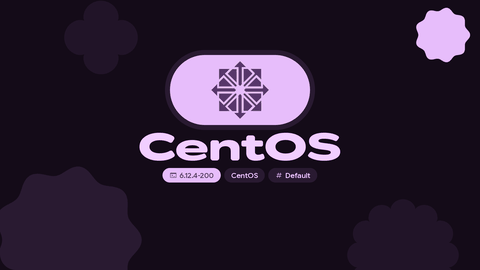 | CentOS | `centos` | `#7A3E9D` (proposed) | `centos-stream`, `centos_stream` |
| 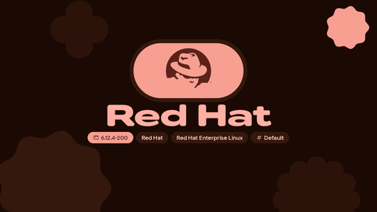 | Red Hat | `rhel` | `#EE0000` (brand colour (Simple Icons)) | `redhat`, `red_hat`, `red-hat` |
| 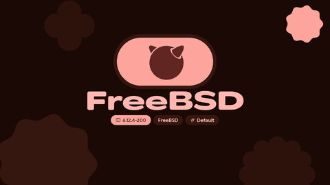 | FreeBSD | `freebsd` | `#AB2B28` (brand colour (Simple Icons)) | - |
| 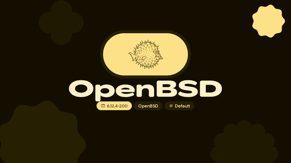 | OpenBSD | `openbsd` | `#F2CA30` (brand colour (Simple Icons)) | - |
| 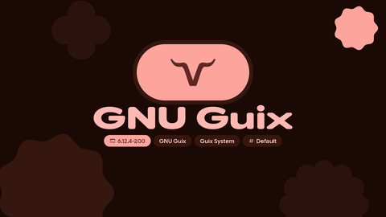 | GNU Guix | `guix` | `#A42E2B` (brand colour (Simple Icons)) | `gnu-guix`, `guix-system` |
| 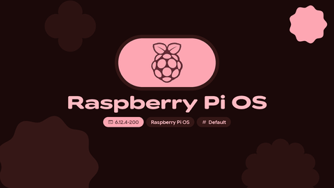 | Raspberry Pi OS | `raspberrypi` | `#A22846` (brand colour (Simple Icons)) | `raspbian`, `raspios`, `raspberry-pi` |
| 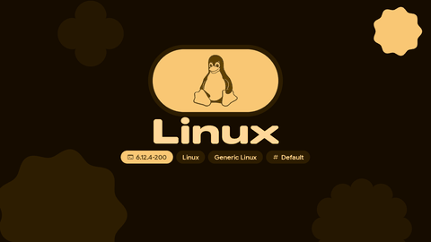 | Linux | `tux` | `#FFB300` (chosen) | - |
|  | Windows 11 | `windows11` | `#0078D4` (chosen) | `windows`, `microsoft`, `windows_boot_manager` |
|  | Windows 10 | `windows10` | `#1E88E5` (proposed) | `win10` |
| 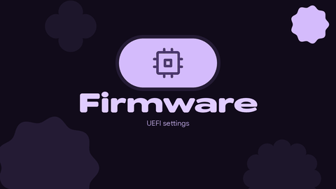 | Firmware | `firmware` | `#7E57C2` (chosen) | `efi`, `uefi`, `uefi-firmware` |
| 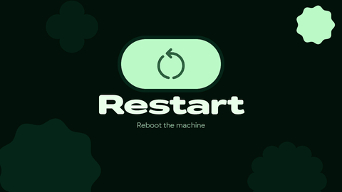 | Restart | `reboot` | `#2E9E5B` (chosen) | `restart` |
| 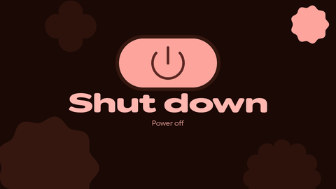 | Shut down | `shutdown` | `#C62828` (chosen) | `poweroff`, `halt` |

Your distro is not listed? [Request it](https://github.com/LucaCraft89/material-grub/issues/new?template=distro_request.yml) (the entry only needs a name, a logo and a colour).

<!-- distros:end -->
