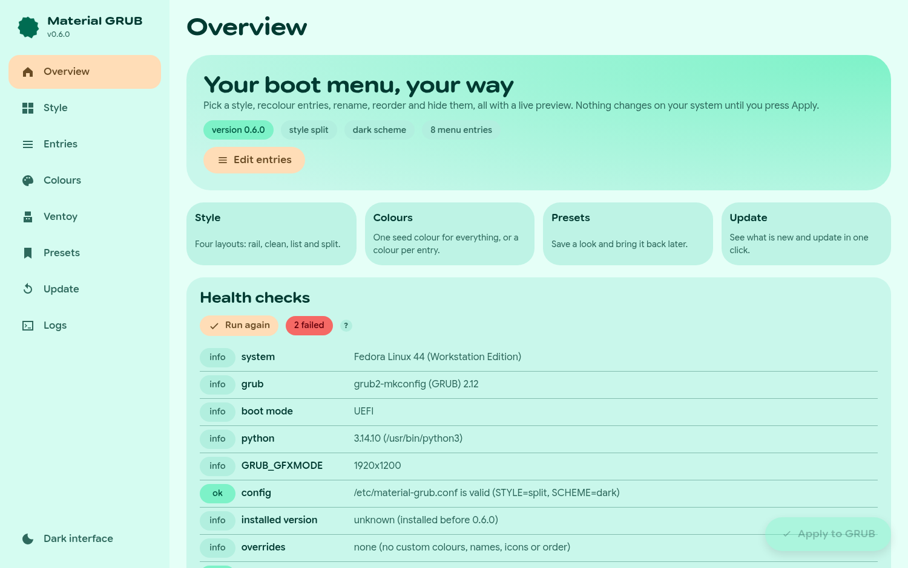

# The GUI

An optional graphical editor for the theme. It is **not installed by default**, and the installer and its TUI never offer or install it. The TUI stays the way to install; the GUI is for changing the look afterwards.

## Get it

- **Packages** (the same repository as the theme): the separate package `material-grub-gui` (`sudo dnf install material-grub-gui`, `sudo apt install material-grub-gui`, `sudo pacman -S material-grub-gui`). It depends on the theme package and ships plain Python and web files, nothing is built.
- **Source install:** `sudo ./install.sh --with-gui` (needs the `gui/` folder of a checkout). `sudo ./install.sh --uninstall` removes it again.
- **From a checkout without installing:** `python3 gui/material-grub-gui` (changes then go through `pkexec` on `gui/mghelper.py`).

Start it with `material-grub-gui` (or *Material GRUB* in your applications menu). It opens in your default browser, at a link with a secret token that is printed in the terminal. Closing the tab stops it after two minutes; so does `Ctrl+C`.

## What it does

- **Overview:** version, health checks (the checks of `material-grub doctor`), shortcuts.
- **Style:** the four layouts with a live preview, the cookie, firmware logo, key hints, raw name, countdown and timeout.
- **Entries:** drag entries (or Alt+arrow keys) to reorder the menu, *Linux first* / *Windows first*, and per entry: name, colour (32 preset colours or any `#RRGGBB`), icon (the built-in ones or your own picture), hidden, and which entries the change covers.
- **Colours:** one seed colour for the whole theme or a colour per entry, with the resulting Material 3 palette.
- **Ventoy:** pick a stick, set its look, and rename, recolour and re-icon single ISOs.
- **Presets:** save the look, import and export it as a file.
- **Update:** checks GitHub for a new release only when you click; updates package installs through your package manager and shows the progress in a pop-up with a verbose log.

Every control has a `?` with a short explanation. The preview is drawn by the same code that writes your real menu, so what you see is what you get; nothing is written until you press **Apply to GRUB**.

## Safety

- The page is served from `127.0.0.1` on a random port. The token in the link becomes a `SameSite=Strict` cookie and must also be sent in a header on every call, the `Host` and `Origin` headers are checked, and no cross-origin request is ever allowed, so another web page cannot talk to it.
- The GUI never runs as root. **Apply** starts `/usr/libexec/material-grub-gui-helper` through `pkexec`: the system asks for your password or fingerprint (every time), and the helper accepts only a fixed list of requests (`apply`, `update`) on stdin, validates every value again, backs up your settings first, and restores them if applying fails.
- The helper only writes `/etc/material-grub.conf`, `/etc/material-grub/` and its backup in `/var/backups/material-grub`, then runs `material-grub-apply`, which validates `grub.cfg` and rolls back when it is wrong, like every other change.
- Ventoy sticks are written as you, not root: a mounted stick already belongs to you.
- Nothing is sent anywhere, except the update check you click (one request to the GitHub releases API without any information about you).

## Troubleshooting

- *"material-grub is not installed (or too old)"*: the GUI needs the theme package of the same release.
- *No password prompt*: you need a polkit agent (every desktop has one). Over SSH use `sudo material-grub-apply` after editing `/etc/material-grub/overrides.json`.
- *Hide or reorder had no effect*: see the limits in [customising.md](customising.md#overridesjson); `material-grub doctor` says when `grub.cfg` must be regenerated.
