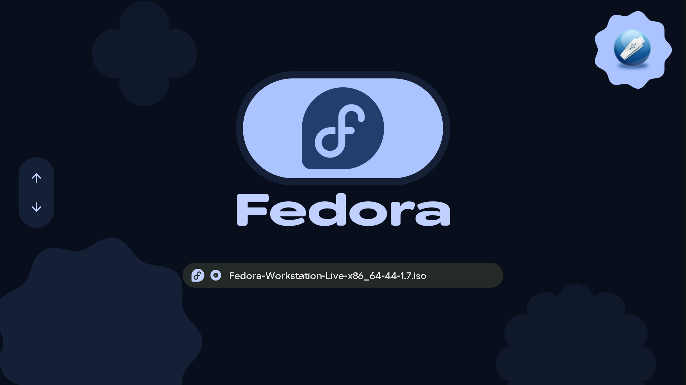
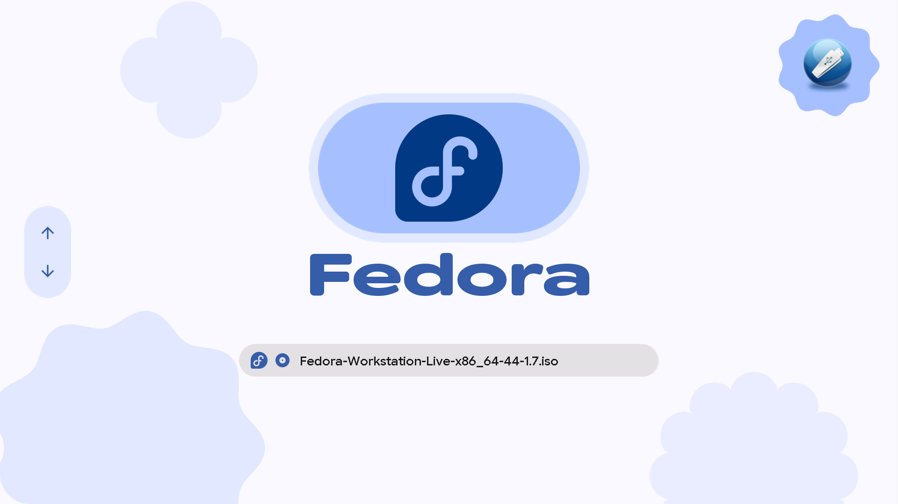
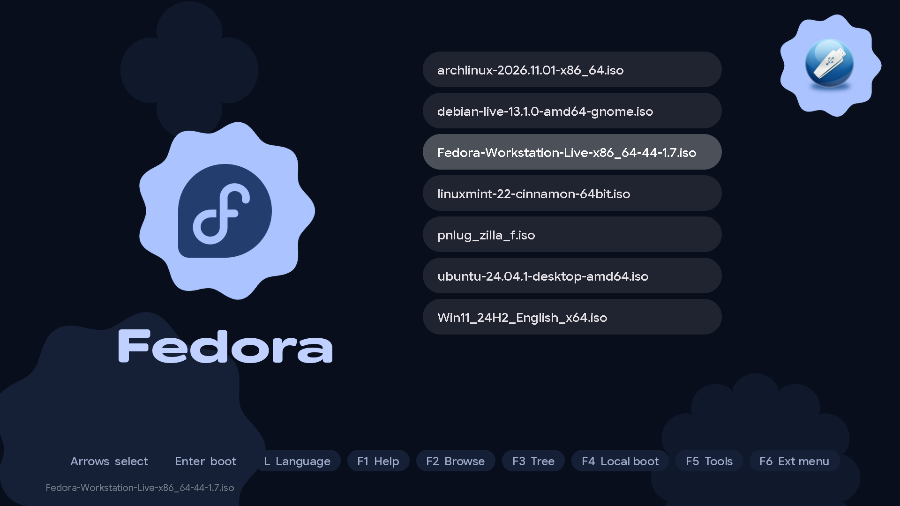
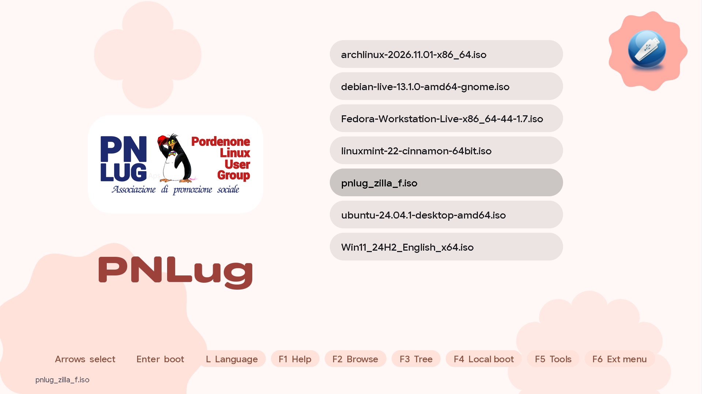
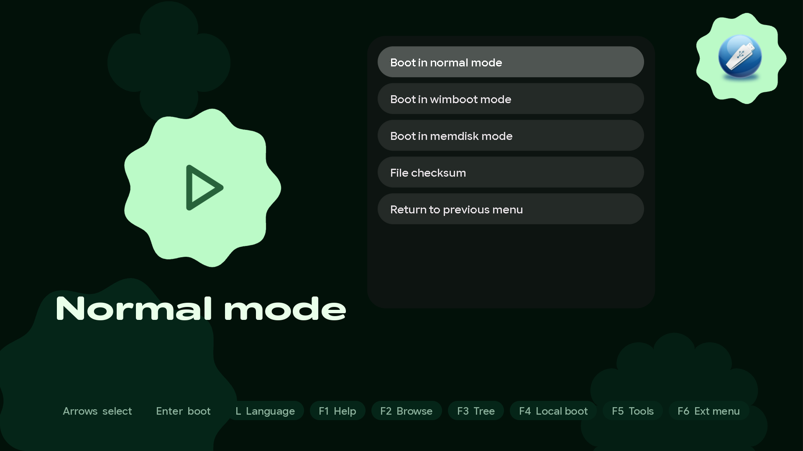
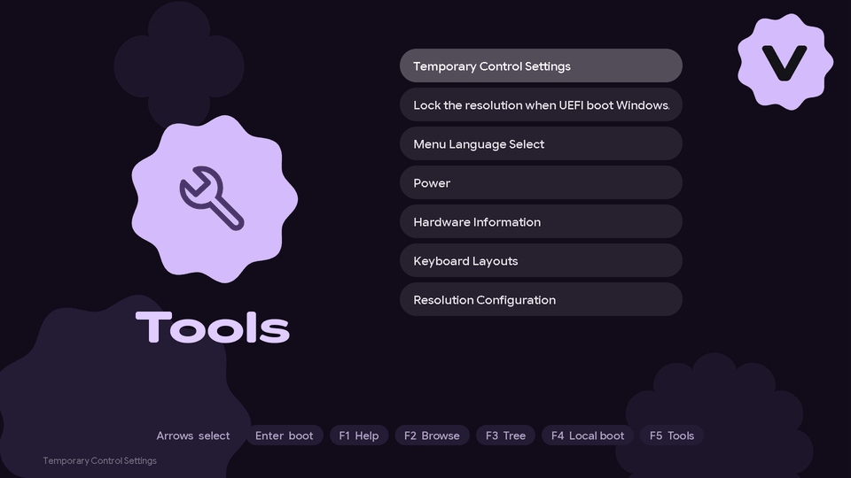

# Material GRUB on a Ventoy stick

Back to the [README](../README.md) · [Gallery](gallery.md) · [Supported distros](distros.md)

The same Material 3 theme, on the menu of a [Ventoy](https://www.ventoy.net) USB stick: the two styles (`full` screen picker and `list`), dark and light, the cookie, Ventoy's own key hints, and a scene per distro in that distro's colour. The shown name is the ISO's raw file name.

It follows the files on the stick: **add, rename or remove ISOs on any computer (Windows included) and the theme keeps working, nothing to run again.**

<table>
<tr>
<td></td>
<td></td>
</tr>
<tr>
<td></td>
<td></td>
</tr>
<tr>
<td></td>
<td></td>
</tr>
</table>

More (both styles, dark and light, PNLug, F3 tree view): the [gallery](gallery.md#ventoy).

<sub>Real Ventoy 1.1.18 booted in QEMU + OVMF. In the top-right cookie the Ventoy logo replaces the firmware logo used on a PC. Ventoy's own menus (F3 tree view, F4 local boot, F5 tools) are themed too.</sub>

## Install

You need a stick that already runs Ventoy (this does not install Ventoy itself) and a clone of this repository.

```sh
./install.sh --ventoy
```

In a terminal this opens the installer UI: it first asks "this computer's GRUB or a Ventoy stick", then shows the Ventoy sticks it finds (mounted or not; it identifies them by Ventoy's `VTOYEFI` partition) and asks for the resolutions, style, colour scheme, logo, key hints and mode. The last tab shows the equivalent command line. It builds the theme from source like the PC installer does (about 2 to 4 minutes the first time), copies it onto the stick and merges it into `/ventoy/ventoy.json`.

No root is needed: it only writes to the stick. Use `sudo` if you want it to install missing build dependencies for you, or to mount a stick that is not mounted yet.

Without the UI:

```sh
./install.sh --ventoy /run/media/$USER/Ventoy --style list --scheme dark --res 1920x1080 --yes
./install.sh --ventoy /run/media/$USER/Ventoy --style full --scheme light --res 1920x1080,2560x1440,3840x2160 --no-logo --no-hints --yes
./install.sh --uninstall --ventoy /run/media/$USER/Ventoy
```

| Option | Meaning |
|---|---|
| `--ventoy [MOUNTPOINT]` | Install on a Ventoy stick. The mount point is the Ventoy data partition (the big one, with the `ventoy` folder). Leave it out to pick the stick in the UI. |
| `--style full\|list` | `full`: the ISO picker is full screen, every other Ventoy menu is the list. `list`: the list everywhere. (`rail` and `clean` from older versions mean `full`.) |
| `--scheme dark\|light` | Colour scheme (chosen when the images are built). |
| `--res A,B,C` | One theme per screen size; see [Resolutions](#resolutions). The first is the size Ventoy starts in. |
| `--mode dynamic\|snapshot` | `dynamic` (default) follows the files on the stick; see [Dynamic and snapshot](#dynamic-and-snapshot). |
| `--no-cookie`, `--no-logo`, `--no-hints` | Hide the top-right cookie, only its logo, or the key-hint pills. |
| `--uninstall --ventoy MOUNTPOINT` | Remove the theme and the rules it added; your own settings stay. |

Options are saved on the stick in `/ventoy/material-grub.conf` (`STYLE`, `SCHEME`, `COOKIE`, `LOGO`, `HINTS`, `RAW_NAME`, `MODE`). To change the style, scheme or resolutions, run the installer again.

## Customise single images (optional)

Rename, recolour or re-icon single ISOs, or give the whole stick one colour: in the [GUI](gui.md) (the *Ventoy* page) or by hand in `ventoy/material-grub-overrides.json` on the stick (same format as [customising.md](customising.md#overridesjson); the match for a file is `{"title": "text of the file name"}`; pictures go in `ventoy/material-grub-icons/`). `material-grub ventoy` writes it to the stick again. A customised file gets its own scene, a `menu_class` rule (the shortest piece of its name that no other file has) and, with a name, that name is drawn in big letters on the image's screen (checked on real Ventoy 1.1.18) and also written as a Ventoy `menu_alias`. **Limit:** Ventoy 1.1.18 did not show that alias in its own list when tested (not with a plain Ventoy menu either), so the list rows keep the file name; the alias is there for Ventoy versions that use it. Hiding and ordering do not apply (Ventoy sorts by name).

## What you see

- **The scene** for the highlighted ISO: its distro's colour, logo and name, in the style you chose. The small muted line at the bottom is the raw file name exactly as Ventoy lists it (`RAW_NAME=off` hides it).
- **`full` (full screen)** only changes the ISO picker: no rail, no neighbours, no key hints; two small rounded arrows on the left hint that the list scrolls. Under the smaller distro name sits a wide pill with the distro logo, a disc icon (it is a disk image) and the real file name in a larger font (`RAW_NAME=off` removes the pill). Every other Ventoy menu (F2 browse, F3 folders, F4 local boot, F5 tools, the boot-mode menu) falls back to the list layout: the logo and name on the left, GRUB's own list on the right.
- **`list`**: the distro's logo and name on the left and the ISO list on the right.
- **Key hints** at the bottom show every key on Ventoy's own bar (Ventoy 1.1.18): the arrows and Enter, **L** Language, **F1** Help, **F2** Browse (boot a file from the local disk), **F3** Tree view (folders instead of one flat list), **F4** Local boot (boot Windows or another disk, a UEFI file), **F5** Tools (resolution, theme, power, hardware info, keyboard layout), **F6** Ext menu (your own `/ventoy/ventoy_grub.cfg`).
- **Ventoy's own menus** have scenes too: folders in tree view (Folder, Back), F4 (Windows, Local boot), F5 (Tools, with Restart, Shut down and Firmware items using their own scenes).
- **The boot-mode menu** (Enter on an image) has a scene per mode, each in its own colour with its own icon: Normal mode (green, play), GRUB2 mode (amber, terminal), WIMBOOT mode (blue, window), Memdisk mode (violet, chip), File checksum (cyan, hash) and Back. Ventoy only offers the modes that fit the image.
- **PNLug (Pordenone Linux User Group):** any image whose name contains `pnlug` in any letter case (`pnlug_zilla_f.iso`, `PNLUG-Fedora.iso`, ...) gets the association's own colours (its red) and its logo on a white card, in both styles. It wins over every other match, even if the name also says Fedora. The logo is `vendor/pnlug/logo.png`.
- **Windows ISOs** are recognised as Windows 10 or Windows 11 from the name (`Win10`, `Windows_11`, ...); a plain "Windows" name gets Windows 11.
- **Anything it does not recognise** (a rescue tool such as GParted or Clonezilla, an unknown distro, a `.wim` or `.img` file) gets a neutral **gray "Disk image" scene with a disc icon**, in every style and in both schemes. The raw file name is still shown, and the entry boots as usual.

## Dynamic and snapshot

Ventoy builds its menu at boot from whatever files are on the stick, and GRUB cannot draw per-file scenes by itself. The theme solves this in one of two ways:

**Dynamic (default).** Nothing depends on the files. The installer puts a scene for every supported distro on the stick plus about 600 generic matching rules (see [How matching works](#how-matching-works)). Any ISO you add later is recognised on its name alone. In the `list` style the rows are drawn by GRUB itself, so the list is always the real one and scrolls for any number of ISOs. The price:

- in `list`, the highlighted row has a neutral colour (GRUB theme colours are global) and rows have no per-row icons or section dividers (GRUB draws a row's icon from the same image file as the full-screen scene, so a small icon next to each ISO cannot be made without losing the per-distro backgrounds); the distro's logo and colour are in the big scene beside the list;

**Snapshot.** The installer looks at the ISOs on the stick right now and draws the exact PC look for them: the list with an icon in a shape per row, each row highlighted in its own distro's colour, section dividers, neighbours peeking in `clean`. The catch: run the installer again after you change the files. A file added later still boots and is recognised by name only if its name matches; its scene shows the whole list without a highlight.

## How matching works

Ventoy's [`menu_class`](https://www.ventoy.net/en/plugin_menuclass.html) assigns an icon class to an ISO when a `key` is a **case-sensitive substring** of the file name; the first match wins. The theme uses it like this:

- Dynamic mode writes one rule per distro alias and title (`fedora`, `Fedora`, `FEDORA`, `linuxmint`, `Linux_Mint`, `EndeavourOS`, ...) in four letter-cases, longest first so `kubuntu` is tried before `ubuntu`, plus patterns for Windows 10 and 11. Keys shorter than four characters are skipped to avoid false hits.
- Snapshot mode writes one rule per file: the longest piece of the name (at most 30 characters) that no other file contains. Ventoy never matches a key equal to the whole name and ignores keys of 32 characters or more, which is why it does not use the full name.
- Your own `menu_class` rules in `ventoy.json` stay first and win over the theme's. The installer keeps a backup next to the file (`ventoy.json.material-grub.bak`) and only ever removes its own rules.
- The distro list and the names matched are the same as on a PC: see [distros.md](distros.md). A name that matches nothing gets the generic Linux scene. If your ISO is recognised wrongly, add a `menu_class` rule of your own in `ventoy.json`.

## Recognised file names

Matching looks at the **file name only**, not the folder. These are checked by `tests/iso_names.txt` (about 150 realistic names, for example `Fedora-Workstation-Live-x86_64-44-1.7.iso`, `ubuntu-24.04.1-desktop-amd64.iso`, `archlinux-2026.11.01-x86_64.iso`, `EndeavourOS_Mercury-2025.02.08.iso`, `Rocky-9.4-x86_64-dvd.iso`, `openSUSE-Tumbleweed-DVD-x86_64-Current.iso`, `MX-23.3_x64.iso`, `FreeBSD-14.1-RELEASE-amd64-disc1.iso`, `install75.iso` for OpenBSD, `Win11_24H2_English_x64.iso`, `SW_DVD9_Win_Pro_10_22H2_64BIT.ISO`) and the same file also lists generic tools that must stay gray (GParted, Clonezilla, SystemRescue, Memtest86). The names were collected from the distros' download pages and mirrors and from the quickemu project's download script, plus well-known naming; not every one was checked against a live mirror. If one of your files is not recognised, tell us the exact file name in an issue, or add a rule of your own to `ventoy.json`.

## Resolutions

GRUB themes are drawn in pixels, so there is one theme per screen size (about 8 MB for 1080p, 14 MB for 4K) in `/ventoy/themes/material_WxH/`. The first `--res` is Ventoy's start mode (`gfxmode`). With several sizes Ventoy switches to the matching theme when you change the resolution in F5 Tools, Resolution Configuration. Pick the size of the screens you use most as the first one. Sizes that are not built in use the closest theme.

The installer does not use `gfxmode: "max"`: it gave a broken display in the test setup.

## Good to know

- The **countdown bar and `TIMEOUT` are not used** on Ventoy (it has its own timeout setting).
- The cookie shows the Ventoy logo (taken from the Ventoy release, see [THIRD_PARTY.md](../THIRD_PARTY.md)). To use another image give the tool `--logo FILE` (run `python3 install/bin/material-grub-ventoy` directly), or hide the logo with `--no-logo`.
- Empty (0 byte) files are ignored by Ventoy itself, so they never show up.
- Fonts for non-Latin names: Latin text uses the bundled Google Sans Flex bitmap fonts; other scripts fall back to GRUB's own `unicode.pf2` in the list (if present on the machine that runs the installer) and are drawn with an installed system font on the scenes.
- A very long file name is clipped at the edge of its row in the dynamic list and shortened with an ellipsis in the snapshot list and the `clean` chips; the small bottom line shows the name as far as it fits.

## Troubleshooting

| Symptom | Cause / fix |
|---|---|
| The installer does not list my stick | It must be a Ventoy stick (a small `VTOYEFI` partition next to the data partition; this is also how the installer verifies a stick). Mount the data partition and pass its mount point: `--ventoy /run/media/you/Ventoy`. |
| `is not the data partition of a Ventoy stick` | The installer checks that the disk behind the path has Ventoy's small `VTOYEFI` partition (or, as a fallback, that the path already has a `/ventoy` folder). Use the big data partition of a stick prepared with Ventoy, not `VTOYEFI` and not an ordinary USB stick. A fresh Ventoy stick has no `/ventoy` folder yet; the installer creates it. |
| A black screen with only Ventoy's plain text | Ventoy could not find or load a scene icon for that menu item. Re-run the installer; if it persists, open an issue with your Ventoy version and the item's name. |
| The theme looks cut off or too small | The screen size does not match an installed theme. Add that resolution with `--res`, or set Ventoy's resolution in F5 Tools. |
| I want the default Ventoy look back | `./install.sh --uninstall --ventoy MOUNTPOINT`, or restore `ventoy.json.material-grub.bak`. |
| A scene is wrong for one ISO | Add your own `menu_class` rule to `ventoy.json` (yours are kept in front of the theme's). |

## What was tested

Verified with real Ventoy 1.1.18 booted in QEMU + OVMF (UEFI), with no root:

- `full` and `list`, dark and light, in both modes; the cookie, logo, hints and raw-name switches.
- 28 ISOs with long, Cyrillic and Japanese names (the list scrolls, long names are shortened).
- Ventoy's F3 tree view, F4 local boot and F5 tools menus.
- Themes for 1920x1080, 2560x1080 and 3840x2160 on one stick, picked by Ventoy for the screen size.
- **ISOs changing without a re-run:** `tests/ventoy_smoke.py` installs the theme onto a stick image, then adds, renames and removes ISOs in the image and boots again. The right distro scene appears for each file and no file under `/ventoy` changes. The same test runs in CI.

Not tested: real hardware, BIOS (legacy) boot, other Ventoy versions, mounting a stick that is not yet mounted, F2 browse, F6 external menu.

Run the stick test yourself (needs `qemu-system-x86_64`, OVMF, `mtools`; it downloads Ventoy once and checks its SHA-256):

```sh
.venv/bin/python scripts/package.py --res 1920x1080
python3 tests/ventoy_smoke.py
```

## For developers

- `install/bin/material-grub-ventoy` does the work (scan, scene rendering through `install/bin/mgscenes.py`, `ventoy.json` merge); `install/ventoy_sticks.py` finds sticks; `install/tui.py` has the Ventoy questions; `install.sh --ventoy` ties them together.
- The design notes, the findings about Ventoy's matcher and the GRUB list quirks (items grow downwards by their pixmap's edge size, text is clipped to the item rectangle, so the list is two synchronised menus) are in [plans/ventoy.md](plans/ventoy.md).
